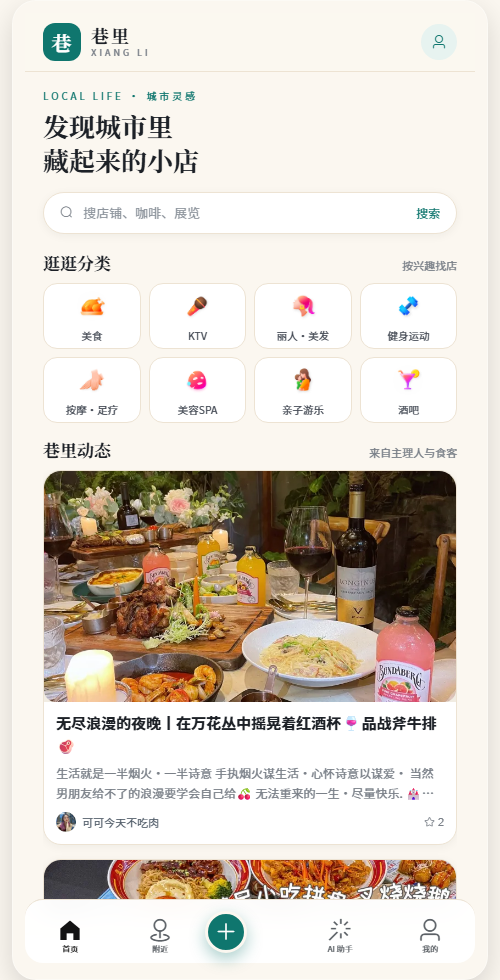
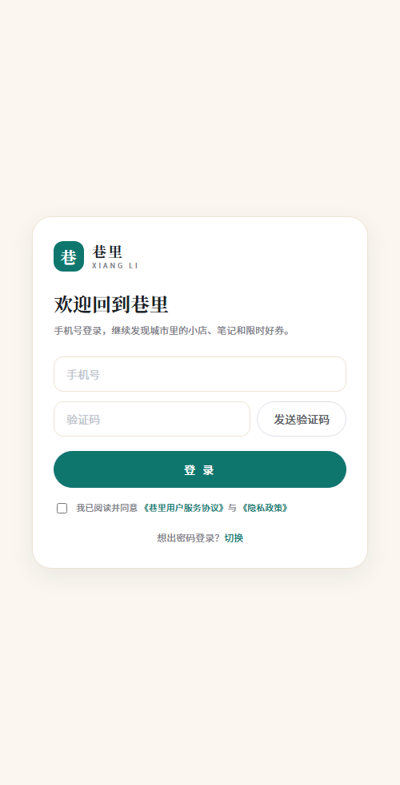
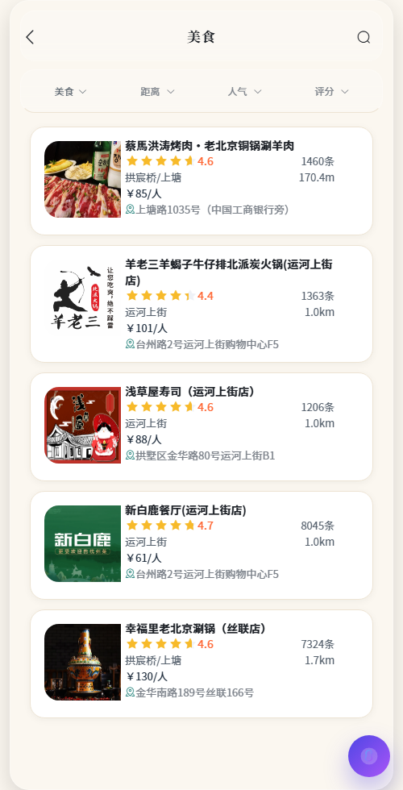
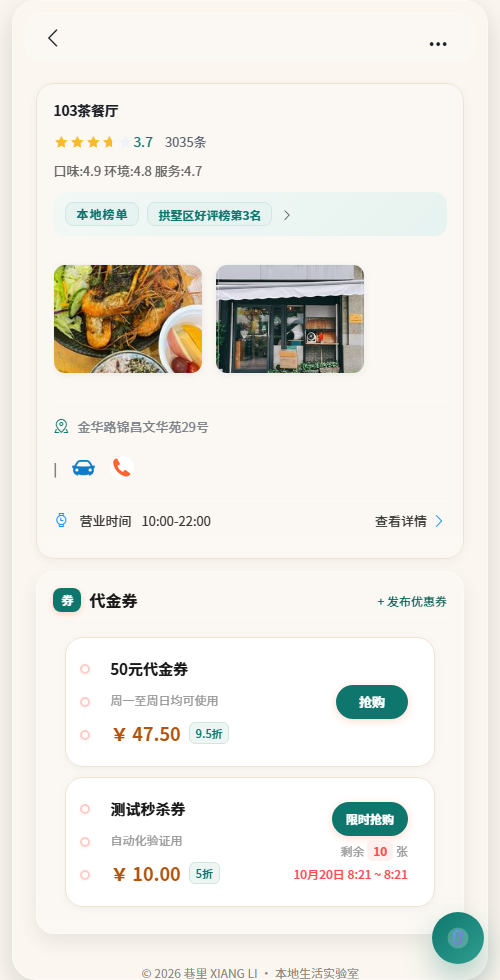

# 巷里 XIANG LI · AI 智能经营中台

> 面向本地生活场景的全栈项目：店铺浏览、探店笔记、优惠券秒杀、预约，并叠加 **AI Skills 技能中心**、**AI 智能客服** 与 **MCP Server**，探索「业务 + AI」的智能经营中台。

[](https://spring.io/projects/spring-boot)
[](https://openjdk.java.net/)
[](https://redis.io/)
[](https://www.mysql.com/)
[](https://docs.langchain4j.dev/)

---

## 界面预览

| 首页 | 登录 |
|---|---|
|  |  |

| 店铺列表 | 店铺详情 |
|---|---|
|  |  |

---

## 目录

- [项目简介](#项目简介)
- [核心特性](#核心特性)
- [技术栈](#技术栈)
- [目录结构](#目录结构)
- [快速开始](#快速开始)
- [核心功能说明](#核心功能说明)
- [AI 能力](#ai-能力)
- [MCP Server](#mcp-server)
- [接口清单](#接口清单)
- [常见问题](#常见问题)
- [注意事项与边界](#注意事项与边界)

---

## 项目简介

AI 智能经营中台是一个本地生活系统，保留了常见的本地生活业务：用户登录、店铺浏览、探店笔记、点赞、关注、优惠券、秒杀订单和预约，并在此基础上增加了 AI 能力。

项目的 AI 定位明确：**用户选择一个固定技能，填写表单，系统根据技能模板调用大模型并返回一份可继续编辑的结果**。AI 不负责自主规划任务，也不会自己决定调用哪些业务接口，更不会直接替用户发布笔记、创建订单、发放优惠券或修改业务状态。

---

## 核心特性

### 业务功能
- **用户体系**：手机号验证码登录、Token 刷新、签到
- **店铺模块**：店铺详情、附近店铺（GEO）、店铺搜索、二级缓存
- **探店笔记**：发布笔记、点赞、评论、关注流（Feed）
- **社交关系**：关注 / 取关、共同关注
- **优惠券与秒杀**：普通券、秒杀券、Redis Lua 原子扣减、Stream 异步下单、幂等保障
- **预约功能**：店铺预约、预约查询、重复预约校验

### AI 能力
- **AI Skills 技能中心**：8 个内置技能，动态表单渲染，运行记录追踪
- **AI 智能客服**：流式对话、多轮记忆、业务工具调用（店铺 / 优惠券 / 订单 / 预约 / AI Skill）
- **MCP Server**：对外暴露 11 个业务工具，支持外部 MCP 客户端接入

### 架构亮点
- **多级缓存**：Guava 本地缓存 + Redis 分布式缓存 + BloomFilter 防穿透
- **Redis GEO**：附近店铺 5 公里范围查询，按距离排序
- **秒杀架构**：Lua 脚本原子操作 + Redis Stream 异步消费 + Redisson 分布式锁 + 数据库唯一索引
- **启动预热**：BloomFilter 初始化、GEO 坐标预热、秒杀库存预热

---

## 技术栈

| 层次 | 技术 | 作用 |
|------|------|------|
| Web 框架 | Spring Boot 3.5.6 | 应用启动、REST 接口、Servlet |
| ORM | MyBatis-Plus 3.5.14 | 实体映射、条件查询、分页 |
| 数据库 | MySQL 8 | 用户、店铺、笔记、优惠券、订单、技能记录 |
| 缓存 / 中间件 | Redis | 验证码、Token、缓存、GEO、ZSet、Set、Bitmap、Stream |
| 分布式锁 | Redisson | 秒杀订单用户级幂等控制 |
| 本地缓存 | Guava Cache | 店铺详情进程内二级缓存 |
| 防穿透 | Guava BloomFilter | 拦截不存在的店铺 ID |
| AI 框架 | LangChain4j + OpenAI 兼容接口 | 调用 DashScope Qwen 模型 |
| 工具调用 | LangChain4j Tools / MCP | 智能客服工具、外部 MCP 工具 |
| 前端 | Vue 2 + Element UI + Axios | 页面交互、表单、API 请求 |
| 静态服务 | Nginx | 托管前端页面，`/api` 反向代理到后端 |

> **注意**：AI 相关依赖同时包含 `1.0.1` 和 `1.0.1-beta6` 系列，升级时需确认 LangChain4j 各模块的兼容关系，不要只修改其中一个版本。

---

## 目录结构

```
heimadianping-AI-master/
├── db.sql                              # 数据库初始化脚本
├── README.md                           # 项目说明
├── PROJECT_GUIDE.md                    # 详细项目文档
├── AI-dianping-backend/                # 后端 Spring Boot 工程
│   ├── pom.xml
│   └── src/
│       ├── main/
│       │   ├── java/com/hmdp/
│       │   │   ├── config/             # Spring、Redis、缓存、MCP 配置
│       │   │   ├── controller/         # HTTP 接口层
│       │   │   ├── dto/                # 请求、响应、通用结果对象
│       │   │   ├── entity/             # 数据库实体
│       │   │   ├── interceptor/        # 登录态、Token 刷新拦截器
│       │   │   ├── mapper/             # MyBatis-Plus Mapper
│       │   │   ├── mcp/                # MCP Server 和工具注册
│       │   │   ├── service/            # 业务接口和实现
│       │   │   ├── tools/              # LangChain4j 智能客服工具
│       │   │   └── utils/              # Redis、缓存、锁、用户上下文工具
│       │   └── resources/
│       │       ├── application.yml     # 数据库、Redis、端口、模型配置
│       │       ├── seckill.lua         # 秒杀库存和防重复下单脚本
│       │       └── system.txt          # 智能客服系统提示词
│       └── test/                       # Spring Boot 测试、GEO 数据加载
└── AI-dianping-frontend/               # 前端（Nginx 托管静态页面）
    ├── nginx.exe                       # Windows Nginx
    ├── conf/nginx.conf                 # 静态文件和 API 代理配置
    └── html/hmdp/                      # Vue 2 + Element UI 静态页面
```

> 前端没有独立的 npm 工程，页面使用仓库内的 Vue、Axios 和 Element UI 文件，由 Nginx 直接托管。

---

## 快速开始

### 环境要求

- **JDK** 17+
- **Maven** 3.6+
- **MySQL** 8.x（数据库名默认 `hmdp`）
- **Redis** 6.x+
- **Nginx**（Windows 版已包含在前端目录中）
- （可选）大模型 API Key，用于 AI 对话和技能生成

### 1. 初始化数据库

```bash
# 创建数据库
mysql -uroot -proot -e "CREATE DATABASE IF NOT EXISTS hmdp DEFAULT CHARACTER SET utf8mb4;"

# 执行初始化脚本（会 DROP 已有表，请勿在生产库执行！）
mysql -uroot -proot hmdp < db.sql
```

### 2. 配置连接信息（环境变量）

不要把账号密码写进 `application.yml`（仓库里只有占位默认值）。复制 `.env.example` 为 `local.env.ps1`，填入本机取值：

```powershell
$env:DB_USERNAME = 'root'
$env:DB_PASSWORD = '<your-db-password>'
$env:REDIS_HOST = '<redis-host>'          # 本机 Redis 可留空
$env:REDIS_PASSWORD = '<redis-password>'
$env:IMAGE_UPLOAD_DIR = '<project>/AI-dianping-frontend/html/hmdp/imgs/'
$env:LOG_PATH = '<project>/logs/backend'
```

`local.env.ps1` 已加入 `.gitignore`，`start-all.ps1` 会自动加载它。

设置大模型 API Key（环境变量）：

```bash
# Windows PowerShell
$env:API_KEY = "你的模型 API Key"

# Linux / macOS
export API_KEY="你的模型 API Key"
```

> 未配置可用模型时，AI Skills 会返回本地兜底内容；AI 智能客服的实时对话仍需要可用的模型配置。

### 3. 启动后端

```bash
cd AI-dianping-backend
mvn spring-boot:run
```

后端默认端口：`8081`，入口类：`com.hmdp.HmDianPingApplication`

### 4. 启动前端

```bash
cd AI-dianping-frontend
# Windows
.\nginx.exe -p "$PWD" -c conf/nginx.conf

# Linux / macOS
nginx -p "$PWD" -c conf/nginx.conf
```

访问：`http://localhost:8080`

停止 Nginx：`nginx -p "$PWD" -s stop`

### 5. （可选）加载附近商户 GEO 数据

执行 `AI-dianping-backend/src/test/java/com/hmdp/HmDianPingApplicationTests.java` 中的 `loadShopData` 方法，将店铺坐标写入 Redis GEO。

### 6. 运行测试

```bash
cd AI-dianping-backend
mvn test          # 单元测试，不依赖 MySQL/Redis
```

需要真实中间件的集成测试（`HmDianPingApplicationTests`）默认跳过，本地显式开启：

```powershell
$env:RUN_INTEGRATION_TESTS='true'
mvn test
```

> CI（`.github/workflows/ci.yml`）在每次 push/PR 时执行 `mvn verify`。

### 7. Docker 一键部署（可选）

```bash
cp .env.docker.example .env      # 按需修改密码
docker compose up -d --build
# 访问 http://localhost:8080，RabbitMQ 管理台 http://localhost:15673
```

包含 MySQL、Redis、RabbitMQ、后端、Nginx 五个服务。原理与排错见
[部署/安全/压测教学](docs/tutorial-deploy-security-loadtest.md)。

### 8. 更多文档

| 文档 | 内容 |
|---|---|
| [docs/hmdp-Java-技术栈教学手册.docx](docs/hmdp-Java-技术栈教学手册.docx) | **Word 版完整教学手册**（按项目结构讲技术栈，含部署/安全/压测，38 页） |
| [docs/tutorial-deploy-security-loadtest.md](docs/tutorial-deploy-security-loadtest.md) | 部署工程化 · 安全加固 · 压测（概念 + 实现 + 实测 + 自检题） |
| [docs/tech-stack.md](docs/tech-stack.md) | 技术栈学习地图（按模块对照项目文件与自检问题） |
| [docs/refactor-log.md](docs/refactor-log.md) | 改造记录（每批改动的动机与影响面） |
| [DEPLOY.md](DEPLOY.md) | 本地部署运维手册 |

---

## 核心功能说明

### 登录与用户上下文

- 登录分两步：发送验证码 → 提交登录，验证码写入 Redis `login:code:{phone}`
- 登录成功后用户信息存入 Redis Hash `login:token:{token}`，前端保存 Token 到 `sessionStorage`
- 双拦截器机制：`RefreshTokenInterceptor` 刷新 Token 有效期，`LoginInterceptor` 校验登录态
- 请求结束后清理 ThreadLocal，避免线程复用导致用户串数据

### 店铺查询与缓存体系

店铺详情查询链路：

```
请求 → BloomFilter(一定不存在? → 返回空)
     → Guava 本地缓存(命中? → 返回)
     → Redis 缓存(命中? → 返回)
     → Redis 互斥锁 → 双重检查 → 查询 MySQL → 写入 Redis + 本地缓存 → 返回
```

- 本地缓存上限 10,000 key，TTL 不超过 300 秒
- Redis 店铺缓存默认 30 分钟，写入时增加 3-10 分钟随机过期时间防雪崩
- 空值缓存 2 分钟防穿透
- 附近店铺使用 Redis GEO 查询 5 公里范围，按距离排序

### 探店笔记与社交

- 发布笔记后推送到粉丝收件箱 ZSet `feed:{followerId}`，实现关注流
- 点赞使用 Redis ZSet `blog:liked:{blogId}` 记录点赞用户，支持点赞 / 取消
- 关注关系存入 Redis Set `follows:{userId}`，共同关注使用 `SINTER`

### 优惠券与秒杀

秒杀下单流程：

```
用户请求 → Redis Lua 脚本(校验库存 + 用户限购 + 扣减库存 + 写入 Stream)
         → 返回订单 ID
         → 异步消费者(XREADGROUP) → Redisson 用户级锁 → 数据库幂等校验 → 扣减库存 + 保存订单 → XACK
```

- Lua 脚本保证库存校验、限购判断、扣减、消息发送的原子性
- 消费者使用用户级分布式锁 + 数据库唯一索引双重幂等保障
- 业务失败（重复订单 / 库存不足）会确认消息，避免无限重试

### 预约功能

- 支持创建预约、查询预约详情、查询我的预约
- 校验：登录态、店铺存在、人数 > 0、预约时间不早于当前时间、同用户同店铺同时间不重复
- AI 客服可通过工具查询和创建预约

---

## AI 能力

### AI Skills 技能中心

内置 8 个技能：

| 编码 | 名称 | 适用场景 |
|------|------|----------|
| `blog_draft` | AI 写探店笔记 | 用户内容创作 |
| `review_summary` | AI 总结店铺评价 | 商家运营 |
| `review_reply` | AI 生成评价回复 | 商家客服 |
| `coupon_copy` | AI 生成优惠券文案 | 商家营销 |
| `shop_tags` | AI 提取店铺标签 | 推荐和搜索 |
| `merchant_daily_report` | AI 生成经营日报 | 商家经营分析 |
| `short_video_script` | AI 生成短视频脚本 | 内容营销 |
| `promotion_plan` | AI 生成活动方案草稿 | 活动策划 |

**执行流程：**

```
用户选择 Skill → 填写表单 → 后端渲染 prompt_template
→ 调用大模型 → 保存运行记录 → 返回结果
```

- 技能定义保存在 `tb_ai_skill`，查询失败时有代码内置技能兜底
- 每分钟每用户限制 20 次调用
- 输入中包含 `shopId` 时，自动拼接店铺详情和最多 3 张优惠券作为业务上下文
- 模型调用失败时返回本地兜底文案
- 所有运行记录存入 `tb_ai_skill_run`，前端展示最近 20 条
- 前端页面 `skills.html` 根据技能的 `inputSchema` 动态生成表单

**接口：**

```
GET  /ai/skills              # 技能列表
GET  /ai/skills/{code}       # 技能详情
POST /ai/skills/{code}/run   # 执行技能
GET  /ai/skills/runs         # 运行记录
```

**调用示例：**

```http
POST /ai/skills/blog_draft/run
Content-Type: application/json
Authorization: {token}

{
  "merchantId": null,
  "input": {
    "shopName": "103茶餐厅",
    "keywords": "招牌菜、环境、服务、人均",
    "tone": "真实、有烟火气"
  }
}
```

### AI 智能客服

- 接口：`GET /chat?memoryId={id}&message={message}`，返回 UTF-8 文本流
- 前端页面：`aiassistant.html`
- 基于 LangChain4j `@AiService`，配置流式聊天模型和多轮记忆
- 每个 memory ID 最多保存 20 条消息，Redis 存储，TTL 1 天
- 系统提示词要求涉及业务数据时优先调用工具，不凭空编造

**注册的业务工具：**

| 工具 | 功能 |
|------|------|
| ShopTool | 店铺详情、店铺类型、附近店铺、名称搜索 |
| VoucherTool | 按店铺查询普通券和秒杀券 |
| OrderTool | 查询当前用户优惠券订单（按状态筛选） |
| ReservationTool | 预约详情、我的预约、创建预约 |
| AiSkillTool | 查询已启用技能、调用固定 Skill |

---

## MCP Server

- 端点：`/mcp`
- 传输方式：无状态 HTTP Servlet Transport
- 注册工具：

| 工具 | 说明 |
|------|------|
| `queryShopById` | 根据 ID 查询店铺 |
| `queryShopTypes` | 查询店铺类型 |
| `queryNearbyShops` | 附近店铺查询 |
| `searchShopByName` | 按名称搜索店铺 |
| `queryVouchersByShopId` | 查询店铺优惠券 |
| `queryMyOrders` | 查询用户订单 |
| `queryReservationById` | 查询预约详情 |
| `queryMyReservations` | 查询我的预约 |
| `createReservation` | 创建预约 |
| `queryEnabledAiSkills` | 查询已启用 AI 技能 |
| `invokeAiSkill` | 调用 AI 技能 |

> ⚠️ **安全警告**：`/mcp` 和 `/mcp/**` 当前被排除在登录拦截器之外。暴露到公网前，必须在网关、反向代理或 MCP Server 层增加认证和来源限制。工具参数中的 `userId` 不能单独承担完整的身份认证职责。

---

## 接口清单

### 用户
```
POST /user/code          # 发送验证码
POST /user/login         # 登录
POST /user/logout        # 登出
GET  /user/me            # 当前用户信息
GET  /user/{id}          # 按 id 查用户
GET  /user/info/{id}     # 用户资料（城市/简介/性别/生日）
PUT  /user/info          # 更新当前用户资料（昵称同步 Redis 登录态）
POST /user/sign          # 签到
GET  /user/sign/count    # 签到统计
```

### 店铺
```
GET /shop/{id}           # 店铺详情
GET /shop/of/type        # 按类型查询店铺（附近 GEO；sortBy=distance|comments|score）
GET /shop/of/name        # 按名称搜索店铺
GET /shop-type/list      # 店铺类型列表
```

### 探店笔记
```
POST /blog               # 发布笔记
GET  /blog/hot           # 热门笔记
GET  /blog/{id}          # 笔记详情
PUT  /blog/like/{id}     # 点赞 / 取消点赞
GET  /blog/likes/{id}    # 点赞列表
GET  /blog/of/follow     # 关注流
```

### 关注
```
PUT /follow/{id}/{isFollow}   # 关注 / 取关
GET /follow/or/not/{id}       # 是否关注
GET /follow/common/{id}       # 共同关注
```

### 优惠券和订单
```
GET  /voucher/list/{shopId}        # 店铺优惠券列表
POST /voucher/seckill              # 添加秒杀券
POST /voucher-order/seckill/{id}   # 秒杀下单
```

### 预约
```
POST /reservation        # 创建预约
GET  /reservation/{id}   # 预约详情
GET  /reservation/my     # 我的预约
```

### AI
```
GET  /ai/skills              # 技能列表
GET  /ai/skills/{code}       # 技能详情
POST /ai/skills/{code}/run   # 执行技能
GET  /ai/skills/runs         # 运行记录
GET  /chat?memoryId=&message=  # 智能客服流式对话
```

### MCP
```
GET/POST /mcp           # MCP Server 端点
```

---

## 常见问题

### Redis 连接失败
症状：登录失败、验证码报错、店铺查询失败、秒杀线程不断重试。
检查 `application.yml` 中的 host、port、password，确认 Redis 允许当前机器连接。Spring Data Redis 和 Redisson 必须指向同一个 Redis 实例。

### MySQL 表不存在
确认已在 `hmdp` 数据库执行 `db.sql`，重点检查：`tb_ai_skill`、`tb_ai_skill_run`、`tb_seckill_voucher`、`tb_voucher_order`、`tb_reservation`。

### AI Skills 页面没有技能
先检查登录态，再检查 `/ai/skills` 响应。技能表查询失败时有内置兜底；如果表存在但所有技能 `enabled=0`，接口返回空列表。

### AI 客服报错但 Skills 可以生成
通常是模型配置或流式模型配置不可用。Skills 会捕获异常并返回兜底内容，而智能客服依赖真实的 LangChain4j 对话模型。

### 端口被占用
- 后端默认 `8081`，Nginx 默认 `8080`
- 修改 Nginx 端口不需要改 `/api` 代理路径
- 修改后端端口需同步修改 `nginx.conf` 中的 `proxy_pass`

### 图片上传失败
图片上传目录由 `application.yml` 的 `hmdp.image-upload-dir` 决定，可用环境变量 `IMAGE_UPLOAD_DIR` 覆盖，需指向 Nginx 静态目录下的 `imgs`（例如 `<project>/AI-dianping-frontend/html/hmdp/imgs/`）。未配置时默认 `imgs/`。

---

## 注意事项与边界

1. **AI 输出仅作草稿或建议**，不会自动执行商家业务动作（发布、预约、发券、修改状态等），所有操作需用户确认。
2. **MCP 端点无登录保护**，生产部署必须增加独立认证。
3. **新增店铺接口未完成**：`ShopController` 的新增店铺方法目前只返回成功，未真正调用保存逻辑。
4. **Redis 是核心依赖**：登录、缓存、GEO、秒杀、消息队列、多轮记忆均依赖 Redis，Redis 不可用时系统大部分功能无法正常工作。
5. **`db.sql` 包含 DROP TABLE**，是开发初始化脚本，不应直接用于生产数据迁移。
6. **两种认证边界**：普通 HTTP 接口通过 Token 获取用户身份，MCP 工具通过参数传递 `userId`，二者认证机制不同。
7. **不做 RAG、不做 Agent、不让 AI 自主选择工具、不让 AI 自动修改业务状态**。

---

## 推荐验证顺序

1. 访问首页，确认 Nginx 静态页面正常
2. 调用 `/shop-type/list`，确认前后端代理正常
3. 调用 `/shop/1`，确认 MySQL、Redis、BloomFilter、缓存链路正常
4. 完成登录，确认验证码、Token、Redis Hash 正常
5. 打开 `skills.html`，确认技能列表和动态表单
6. 执行 `blog_draft`，观察有模型和 fallback 两种结果
7. 打开 `aiassistant.html`，验证流式聊天和多轮记忆
8. 最后验证秒杀、预约和 MCP

---

## 许可证

本项目为个人学习与求职作品：在开源本地生活课程项目的基础上完成品牌重做、功能增强与工程化改造，仅供学习研究使用。
